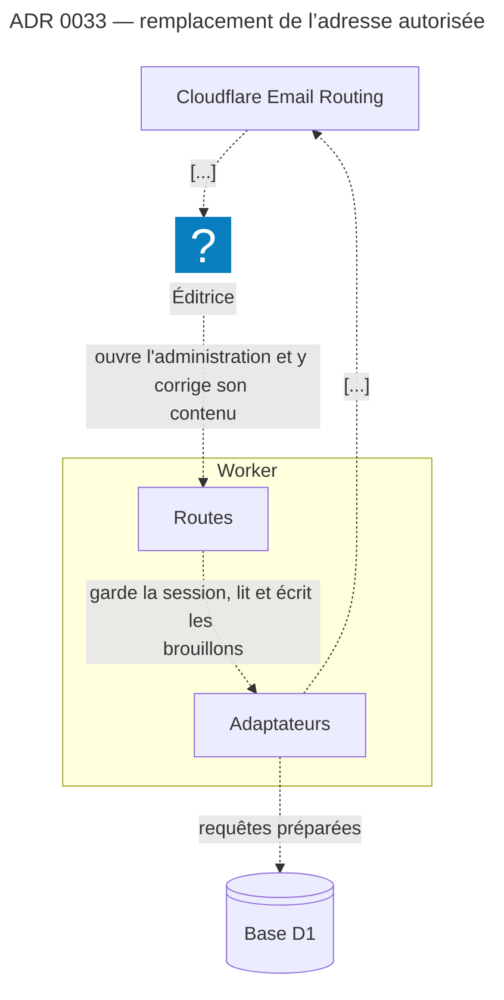

# ADR-0033 : Remplacement de l'adresse autorisée — l'API des adresses de destination de Cloudflare, une clé limitée aux adresses, une liaison d'envoi sans adresse fixe, une double preuve
Statut : Accepté | Date : 2026-11-09

Décision neuve, née de l'arbitrage humain du change `017-remplacement-adresse-autorisee` (option A,
2026-11-09). Elle lève une conséquence de l'[ADR-0002](./0002-acheminement-email-routing-send-email.md),
dont le fichier ne change pas : la redirection vit dans [`README.md`](./README.md). Les numéros cités
sont des numéros 2.x, sauf mention « (1.x) ».

## Contexte

`FR-013` fait remplacer l'adresse autorisée depuis une session ouverte, et `FR-014` ne la fait
devenir autorisée qu'après preuve de sa maîtrise. Le cycle 1.x les avait laissés sans porteur
(`docs/legacy/1.x/stack.md`, § « `FR-013` et `FR-014` »), pour deux raisons :

1. **La plateforme n'écrit qu'aux adresses vérifiées.** L'envoi gratuit de Cloudflare ne vise que
   les adresses de destination **vérifiées** du compte ; écrire à une adresse quelconque exige
   l'offre payante, contre `SC-001`. Vérifier une adresse passait par le compte Cloudflare, que
   `SC-006` interdit de faire visiter à l'éditrice. L'ADR-0002 l'a consigné : « Une destination
   vérifiée ne se remplace pas depuis le produit ».
2. **`FR-005` verrouille `FR-014`** à la lettre : il interdit tout message de preuve à une adresse
   autre que l'adresse autorisée.

Le cycle 1.x connaissait l'issue — appeler l'API Email Routing depuis le Worker — et l'avait écartée :
elle demandait une clé capable de **réécrire le routage du courrier** du client, déposée dans un Worker
exposé, qui changeait une session compromise en interception permanente du courrier.

Faits relevés le 2026-11-09 dans la documentation de Cloudflare :

- l'envoi vers une adresse vérifiée du compte reste **gratuit sur tout plan** ;
- une adresse de destination s'inscrit par l'API (`POST /accounts/{compte}/email/routing/addresses`),
  et Cloudflare envoie lui-même le message de vérification ; son état se lit par `GET` (champ
  `verified`) ;
- une liaison `send_email` **sans attribut de restriction** écrit à toute adresse vérifiée du compte ;
  `destination_address` la limite à une seule ;
- la permission de clé **« Email Routing Addresses Edit »** est de niveau **compte**, distincte de
  **« Email Routing Rules Edit »**, de niveau **domaine**. La première gère la liste des adresses ;
  seule la seconde crée ou modifie une règle qui fait suivre le courrier d'un domaine.

L'[ADR-0005](./0005-configuration-d-instance-quatre-lieux.md) a logé l'adresse autorisée en D1
précisément pour qu'un geste de l'administration puisse un jour la remplacer.

## Décision

Nous remplacerons l'adresse autorisée **depuis l'administration**, par l'**API des adresses de
destination** de Cloudflare, sous quatre conditions.

1. **Une clé limitée aux adresses.** Le Worker porte une clé du compte du client dont la **seule**
   permission est « Email Routing Addresses Edit ». Elle est un secret de la plateforme (lieu 2
   d'ADR-0005), optionnel : sans elle, le remplacement est refusé et rien d'autre ne change.
   L'identifiant du compte, non secret, vit dans `instance.json`.
2. **Une liaison d'envoi sans adresse fixe.** `send_email` perd `destination_address` : elle écrit à
   toute adresse vérifiée du compte du client. C'est le produit qui choisit le destinataire, et il
   n'écrit qu'à l'adresse autorisée lue en base, ou à l'adresse d'un remplacement en cours constatée
   vérifiée.
3. **Une double preuve.** L'adresse candidate doit être **vérifiée chez Cloudflare** — le clic de
   son propriétaire sur le message de Cloudflare —, **puis** recevoir un code du produit, recopié
   **dans la session qui a demandé le remplacement**. Le clic prouve la maîtrise de la boîte ; le
   code la rattache à la personne connectée, et prouve que les messages du produit y arrivent.
4. **Une bascule qui chasse et qui prévient.** En un seul geste : l'adresse change, les codes de
   connexion en circulation cessent d'ouvrir, toute autre session est fermée, et un avis part vers
   l'ancienne adresse. Le produit ne retire jamais une adresse de la liste de Cloudflare.

**`FR-005` se lit comme portant sur l'écran de connexion** : c'est là qu'un inconnu peut faire
écrire à une adresse de son choix. Un code envoyé à une adresse candidate depuis une session ouverte,
après sa vérification par son propriétaire, n'est pas dans son champ. Amender la formulation de
`FR-005` dans `docs/vision.md` reste un geste de cadrage de l'humain.

## Conséquences

**Positives.**

- **`FR-013` et `FR-014` ont un porteur**, et l'éditrice change d'adresse seule, sans visiter
  aucun compte (`SC-006`) et sans l'intégrateur : la promesse tient le jour où Isometria disparaît.
- **L'objection du cycle 1.x tombe sur un fait de la plateforme.** Volée, la clé ne crée ni ne
  modifie aucune règle de routage : le courrier du domaine du client ne se détourne pas par elle.
- **Le remède durable à la boîte piratée existe.** Le cas limite « boîte compromise » ne s'arrête
  plus à l'éviction : avec le code de secours ([ADR-0032](./0032-moyen-de-reprise-code-128-bits-hache.md)),
  l'éditrice entre, remplace l'adresse, et la session de l'intrus est fermée.
- **Le fichier de déploiement ne porte plus d'adresse propre à l'instance.** Sans
  `destination_address`, il redevient identique d'un dépôt de cliente à l'autre (`SC-008`).
- **Basculer vers une boîte injoignable est impossible**, puisque le code du produit doit y être
  arrivé par la liaison même qui servira ensuite.

**Négatives — ce à quoi le code s'engage.**

- **Un secret de plateforme de plus, dans un Worker exposé.** Il s'inventorie à la livraison
  (`SC-013`) et se crée au nom du client. Volé, il peut **retirer** des adresses de destination, ce
  qui couperait l'envoi des codes et des demandes : le code de secours reste la porte, et la clé se
  révoque depuis le compte du client.
- **La plateforme ne tient plus seule `FR-005`.** L'ADR-0002 comptait comme positif que `send_email`
  n'écrive qu'à une adresse fixe. La liaison écrit désormais à toute adresse vérifiée du compte :
  c'est le code qui choisit le destinataire. La plateforme garde une borne — aucune adresse que son
  propriétaire n'a pas confirmée — mais plus la seule adresse autorisée.
- **Une session volée peut détourner l'adresse**, et avec elle les demandes à venir. L'avis à
  l'ancienne adresse le montre, et le code de secours permet de remettre l'adresse. Ce rayon d'action
  existait déjà pour le code de secours (`SEC-8`) ; il s'étend aux demandes.
- **Le message de Cloudflare est en anglais et porte sa marque.** L'écran l'annonce avant, avec le
  libellé exact du bouton. C'est le prix de la voie gratuite.
- **Une dépendance à une API de la plateforme**, que Cloudflare peut changer. Un changement se
  manifeste par un remplacement refusé, jamais par une adresse perdue : l'adresse en place continue de
  servir. La réserve bêta de l'ADR-0002 s'applique aussi à cette API.
- **Les anciennes adresses s'accumulent** dans la liste du compte (au plus 200 par compte). Leur
  ménage est un geste du client, hors produit.

## Alternatives considérées

- **Une personne vérifie l'adresse dans le compte Cloudflare, puis le produit envoie son code** :
  écartée. L'éditrice ne peut pas le faire seule, et le jour où Isometria disparaît, personne ne le
  peut plus.
- **Sortir le remplacement du produit**, en geste de passation au dossier d'instance : écartée. La
  cliente dont la boîte est piratée n'aurait pas de remède durable dans le produit, défaut déjà relevé
  par l'audit d'authentification du cycle 1.x (`AU-02`).
- **L'envoi payant vers une adresse quelconque** (Email Sending) : écartée. Il exige Workers Paid,
  contre `SC-001`, comme l'ADR-0002 l'avait déjà tranché.
- **Le seul clic de Cloudflare comme preuve** : écartée. Il ne prouve ni que la personne connectée
  tient la boîte, ni que les codes du produit y arrivent ; une bascule vers une adresse injoignable
  fermerait l'administration.
- **Une clé aux droits de routage** (« Email Routing Rules Edit ») : écartée. C'est la clé que le
  cycle 1.x refusait à juste titre ; rien dans le remplacement n'en a besoin.
- **`allowed_destination_addresses`** : écartée. La liste figerait les adresses dans le fichier de
  déploiement, et chaque remplacement demanderait un redéploiement.
- **Confirmer aussi depuis l'ancienne adresse** : écartée. L'éditrice qui a perdu sa boîte, et
  entre par le code de secours, ne pourrait jamais remplacer l'adresse. L'avis a posteriori garde la
  visibilité sans ce verrou.

## Modèle

- Éléments touchés : `colibri-cms.worker.platform`, `email-routing` (description étendue),
  `editrice`.
- Delta : `docs/architecture/context.c4` — deux relations ajoutées, marquées `#planned` jusqu'au
  ticket qui pose l'adaptateur : `colibri-cms.worker.platform -[sync]-> email-routing` (inscrit une
  adresse de destination et lit sa vérification), `email-routing -[async]-> editrice` (remet le
  message de confirmation de la nouvelle adresse) ; une vue ajoutée.
- Vue : `adr-0033` — `likec4 validate --no-layout --json --project colibri-cms docs/architecture`
  rend `valid: true`, 0 erreur, le 2026-11-09. Les relations parallèles d'un même couple sont
  regroupées par le rendu sous `[...]`.

## Vérifiable ?

En partie. Il crée l'invariant **`I18`** de `docs/architecture.md` : l'adresse de l'API Cloudflare
n'apparaît dans aucun fichier de `src/` hors de `src/platform/adresses-cloudflare/`, ce qui garde la
clé et ses appels en un seul lieu. La portée de la clé se constate en recette : une clé limitée aux adresses est refusée par
l'API des règles de routage, sortie conservée (change 017, `test-plan.md`). L'absence de
`destination_address` se lit dans les deux fichiers de déploiement, mais c'est une valeur de
configuration : aucun invariant de `docs/architecture.md` ne la porte. Le reste — double preuve,
bascule atomique, avis — dépend du comportement à l'exécution et se vérifie par les tests
d'intégration du change 017.

## Contexte agent (optionnel)

- Décision influencée/générée par l'agent : oui — faits de plateforme relevés dans la documentation
  Cloudflare le 2026-11-09, trois options instruites ; option A arbitrée par l'humain le même jour.
- Proposal, design (D2 à D8) et revue de sécurité : `openspec/changes/017-remplacement-adresse-autorisee/`.
