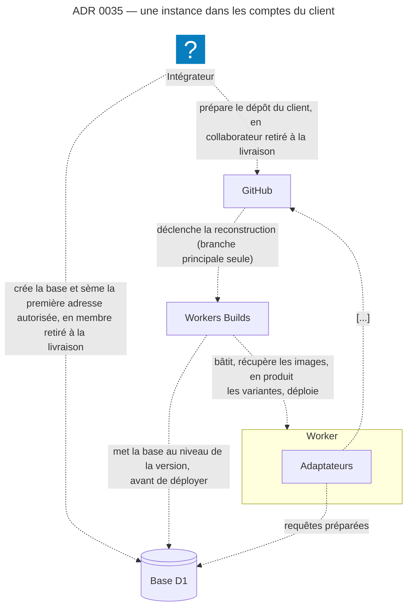

# ADR-0035 : Cible de déploiement et livraison — un Worker unique bâti par Workers Builds dans le compte du client, qui met la base à niveau ; tout objet attaché à une identité naît dans une session du client
Statut : Accepté | Date : 2026-11-18

Décision promue du candidat `cible-de-deploiement-worker-unique-workers-builds` (ADR-0001 du cycle
1.x), pour le change `020-deploiement-instance-client`, avant ses tickets. Elle est **amendée** à la
promotion sur trois points, marqués *(amendé)* ou *(ajouté)* : la construction met la base à niveau,
elle n'emploie aucune clé du dépôt, et une règle fixe au nom de qui naissent les objets d'une
instance. Les numéros cités sont des numéros 2.x, sauf mention « (1.x) ».

## Contexte

ColibriCMS sert un site public **et** son administration depuis une même instance, dans le compte de
chaque client. Deux exigences décident de la cible :

- `FR-081` (aperçu avant publication) demande un aperçu rendu serveur avec les mêmes composants que le
  site publié, donc un adaptateur de rendu serveur ;
- `FR-095` et `FR-096` veulent que le site publié reste des fichiers, et `SC-001` que rien n'exige de
  moyen de paiement.

Le système de construction n'est pas un choix indépendant de la cible : la construction hébergée de
Cloudflare lui est couplée. Et `FR-089` réserve le déclenchement au dépôt du contenu publié : la
branche des images n'est pas un déclencheur.

L'alternative Pages est écartée par un fait daté : `@astrojs/cloudflare` a retiré le support de Pages
à la v13.0.0, publiée le 2026-03-10
(`docs/legacy/research/2026-08-12-adaptateur-astro-pages.md`).

*(ajouté)* Le candidat laissait deux points « à constater », et n'en voyait pas un troisième, celui
dont dépendent `FR-099`, `FR-100`, `FR-101` et `SC-012` : ce qu'il advient d'une instance quand
l'intégrateur est retiré des comptes du client. Faits relevés dans la documentation des plateformes le
2026-11-15, puis constats faits sur le serveur de recette les 2026-11-16 et 2026-11-18
(`openspec/changes/020-deploiement-instance-client/constats/`) :

- **La construction n'accepte qu'une clé d'utilisateur.** Workers Builds : « Currently, only user
  tokens are supported ». Une clé d'utilisateur cesse de fonctionner quand son créateur est retiré du
  compte. Une construction raccordée par l'intégrateur casserait donc la publication à son départ.
- **Le raccordement d'un dépôt liste les seuls dépôts de l'utilisateur GitHub qui raccorde**, depuis
  le 2026-11-10 : un dépôt du client ne se raccorde que depuis sa session.
- **Une clé GitHub à portée fine n'agit que sur les dépôts de son créateur**, peut être créée sans
  expiration, et devient inactive si son créateur perd l'accès au dépôt.
- **La construction met la base à niveau avec la clé qu'elle crée par défaut** — constaté le
  2026-11-18 : une mise à niveau d'essai appliquée puis le déploiement ; une mise à niveau fautive n'a
  rien déployé, n'a pas été inscrite, et la construction suivante a abouti. La documentation ne liste
  pas ce droit, et l'outillage de recette le croyait absent.
- **La construction atteint la branche des images d'un dépôt privé sans aucune clé du dépôt** —
  constaté le 2026-11-18 : le clone qu'elle fait garde l'accès de l'application GitHub de Cloudflare.
  C'était le point 3 de « À constater en recette », que le candidat tenait pour bloquant.
- **L'envoi d'e-mails exige un nom de domaine géré par le DNS Cloudflare du compte**
  ([ADR-0002](./0002-acheminement-email-routing-send-email.md)) ; l'acheter dans ce compte y
  enregistrerait un moyen de paiement.

## Décision

Nous déploierons **un Worker Cloudflare unique** — assets statiques et routes serveur dans le même
artefact — et nous le bâtirons par **Workers Builds**, **dans le compte Cloudflare du client**.

Workers Builds surveillera la branche **`main` seule** du dépôt du client ; la construction récupérera
la branche orpheline `media` pendant son exécution.

*(amendé)* **La mise en ligne est une commande unique, la même pour toute instance : elle met la base
au niveau de la version, puis déploie.** Si la mise à niveau échoue, rien n'est déployé. La même
commande sert la première mise en service, chaque publication de l'éditrice et chaque nouvelle
version. Aucun poste de l'intégrateur n'atteint la base pour la mettre à niveau.

*(amendé)* **La construction n'emploie aucune clé du dépôt.** Il n'existe pas de clé de lecture
`Contents: Read-only`. La clé d'écriture de l'[ADR-0021](./0021-forge-github-api-git-data-jeton-a-portee-fine.md)
reste la seule clé du dépôt, et ne vit que dans le Worker.

*(ajouté)* **Une instance vit dans deux comptes ouverts au nom du client** : un compte Cloudflare, dont
le client est Super Administrateur, et un compte GitHub, propriétaire d'un dépôt privé. L'intégrateur
y est **membre** et **collaborateur**, et rien de plus. Le nom de domaine est acheté par le client hors
du compte Cloudflare, puis délégué à son DNS.

*(ajouté)* **Tout objet dont le fonctionnement dépend de son créateur naît dans une session du
client** : la clé d'écriture du dépôt, la clé des adresses e-mail
([ADR-0033](./0033-remplacement-de-l-adresse-autorisee-par-l-api-des-adresses-de-destination.md)), la
clé de construction, et le raccordement du dépôt à la construction avec l'application GitHub qui le
porte. Ce qui n'est attaché à personne — le Worker, la base, la zone DNS, la première adresse
autorisée, le contenu du dépôt — peut être créé par l'intégrateur membre. Qui tient le clavier n'est
pas l'objet de la règle : l'intégrateur opère les sessions du client en sa présence, et les moyens
d'accès aux comptes restent au client.

*(ajouté)* **La livraison se prouve par l'effet.** Avant de dire une instance livrée, tous les accès
de l'intégrateur sont retirés, puis on constate que le site est servi, que l'administration s'ouvre et
qu'une publication aboutit jusqu'en ligne (`SC-012`).

## Conséquences

**Positives.**

- L'aperçu de `FR-081` est rendu par le même moteur et les mêmes composants que le site publié.
- La branche courante d'Astro reste accessible, au lieu des deux majors de retard qu'imposerait Pages.
- Une publication produit **une seule** construction : `media` ne déclenche rien.
- Les requêtes aux assets statiques sont gratuites et hors quota.
- *(ajouté)* Déployer une version ne demande aucun accès de l'intégrateur à la base : `FR-102` tient
  pour les mises à niveau comme pour le reste.
- *(ajouté)* Une clé de moins qu'attendu à créer, à ranger et à inventorier ; et aucune clé de lecture
  qui mourrait après un an sans publication.

**Négatives — ce à quoi le code et la livraison s'engagent.**

- **Aucune frontière ne peut être tenue par le déploiement.** Un artefact unique signifie que toute
  séparation entre le site, l'administration et la logique métier est interne au dépôt : c'est ce qui
  oblige `docs/architecture.md` à poser des invariants de structure.
- Le Worker est soumis au **plafond de 3 Mo gzip** du palier gratuit : chaque dépendance se pèse.
- **Dix publications en deux minutes font dix constructions**, mises en file une à une ; la
  consommation de minutes est réelle (3 000 par mois sur le palier gratuit).
- **Le produit est couplé à Workers Builds** : changer de système de construction, c'est changer de
  cible de déploiement.
- *(ajouté)* **Entre la mise à niveau et le déploiement, la version en ligne tourne sur une base déjà
  mise à niveau**, et une mise à niveau interrompue laisse la base à un niveau intermédiaire. Chaque
  mise à niveau future doit rester lisible par la version précédente. La règle est à écrire par la
  story « Déployer une nouvelle version » (`FR-105`, `FR-106`).
- *(ajouté)* **Le droit de la construction sur la base n'est écrit nulle part.** Il est constaté sur
  une clé créée le 2026-10-14. S'il manque sur un compte neuf, la clé de construction devra être une
  clé d'utilisateur du client créée avec ce droit, dans sa session. À constater de nouveau à la
  répétition de l'épreuve de livraison.
- *(ajouté)* **La lecture des images par la construction tient au raccordement du dépôt**, non à une
  clé que le produit maîtrise. Si l'application GitHub est désinstallée, la construction échoue sur
  les images absentes ; `COLIBRI_CLE_LECTURE_DEPOT`, que le script sait lire, reste le recours.
- *(ajouté)* **Quatre objets d'identité au nom du client, tous sans rotation ni détection de
  compromission.** C'est la dette que l'ADR-0021 nomme pour la clé d'écriture, étendue aux trois
  autres. L'inventaire de livraison la rend visible, il ne la solde pas.
- *(ajouté)* **La présence du client à la livraison est une condition du produit**, déjà posée par
  l'[ADR-0032](./0032-moyen-de-reprise-code-128-bits-hache.md) pour le code de secours : ses sessions
  sont le seul lieu où ces quatre objets peuvent naître.
- *(ajouté)* **Le nom de domaine a un coût annuel, hors de `SC-001`** : c'est un prérequis du client,
  comme sa boîte e-mail (arbitré par l'humain le 2026-11-16). Le compte du bureau d'enregistrement est
  un troisième compte du client, à inventorier.
- *(ajouté)* **La règle des identités ne se vérifie pas dans le dépôt.** Rien ne dit, à lire un
  compte, au nom de qui une clé a été créée : seule l'épreuve du retrait des accès le prouve, et elle
  demande des comptes qui ne sont pas ceux de l'intégrateur.

## Alternatives considérées

- **Projet Pages + Pages Build** : écartée car l'aperçu rendu serveur y imposerait une branche d'Astro
  que l'adaptateur a quittée ; `FR-105` et `SC-008` feraient porter cette dette par toute la flotte.
- **Surveiller les deux branches (`main` et `media`)** : écartée car le dépôt sur `media` rebâtirait le
  site sur un contenu inchangé.
- *(ajouté)* **Mettre la base à niveau depuis le poste de l'intégrateur**, comme l'outillage de recette
  le faisait. Écartée : chaque version exigerait un accès d'Isometria à la base du client, contre
  `FR-102`, et une instance dont l'intégrateur est parti ne pourrait plus recevoir de version.
- *(ajouté)* **Une clé de lecture séparée pour la construction** (`Contents: Read-only`), que le
  candidat prévoyait. Écartée : inutile, et elle ne servirait qu'aux constructions — une instance sans
  publication pendant un an la perdrait, et la publication suivante échouerait.
- *(ajouté)* **Un compte Cloudflare créé depuis l'utilisateur de l'intégrateur, puis cédé.** Écartée :
  le compte reste rattaché à l'intégrateur tant qu'un autre Super Administrateur n'existe pas, et les
  objets créés entre-temps portent son identité. L'offre « partenaire » exige un contrat.
- *(ajouté)* **Un dépôt créé chez l'intégrateur, puis transféré.** Écartée : l'ancien propriétaire
  reste collaborateur, et le sort du raccordement à la construction n'est pas documenté.
- *(ajouté)* **Un dépôt public.** Écartée : le contenu, les réglages et tout l'historique des
  publications deviendraient publics. La construction lit un dépôt privé sans clé : rien n'y pousse.
- *(ajouté)* **Le bouton « Deploy to Cloudflare ».** Écartée : il exige un dépôt public, et ne sait ni
  l'e-mail ni la mise à niveau de la base.

## Modèle

- Éléments touchés : `integrateur`, `github`, `workers-builds`, `colibri-cms.worker.platform`,
  `colibri-cms.d1`.
- Delta : `docs/architecture/context.c4` — quatre relations ajoutées, marquées `#planned` jusqu'aux
  tickets qui les posent : `workers-builds -[async]-> colibri-cms.d1` (met la base à niveau avant de
  déployer), `colibri-cms.worker.platform -[sync]-> github` (l'appel hebdomadaire de l'ADR-0021),
  `integrateur -> github` et `integrateur -> colibri-cms.d1` (les accès de collaborateur et de membre,
  retirés à la livraison) ; une vue ajoutée. `docs/architecture/deployment.c4` — un environnement
  `production` (« Comptes du client »), ses deux nœuds et sa vue.
- Vue : `adr-0035` — `likec4 validate --no-layout --json --project colibri-cms docs/architecture`
  rend `valid: true`, 0 erreur, le 2026-11-18. Les relations parallèles d'un même couple sont
  regroupées par le rendu sous `[...]`.

## Vérifiable ?

Non, pour l'essentiel. C'est une décision de **fondation** : la cible, la commande de mise en ligne et
la règle des identités se constatent à la recette de livraison, pas dans l'arborescence. Aucun
invariant de `docs/architecture.md` n'en naît : la règle des identités dépend de l'état de comptes
(classe « configuration »), et l'ordre « mise à niveau, puis déploiement » de l'exécution. Ce que le
dépôt peut vérifier — la commande de mise en ligne présente dans `package.json`, le dépôt du client
préparé sans automatisation de la forge — l'est par les tests du change 020.

## Contexte agent (optionnel)

- Décision influencée/générée par l'agent : oui — le candidat avait été instruit en phase Stack et
  arbitré par l'humain le 2026-08-13 ; les amendements sont instruits pendant le change 020, sur faits
  de plateforme sourcés le 2026-11-15 et trois constats joués en recette avec l'humain. Trois points
  arbitrés par l'humain le 2026-11-16 : l'épreuve jouée d'abord en répétition, le domaine hors de
  `SC-001`, la clé d'écriture sans expiration.
- Proposal, design (D1, D2, D4, D10), revue de sécurité et cahiers des constats :
  `openspec/changes/020-deploiement-instance-client/`.
