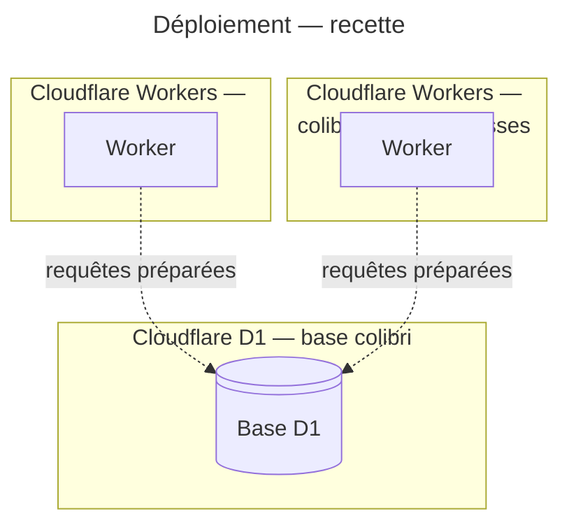

# ADR-0036 : La recette déploie la configuration dérivée telle quelle — un serveur principal aux noms du produit, un second Worker pour les aperçus
Statut : Accepté | Date : 2026-11-21

Décision née en 2.x, pendant le change `020-deploiement-instance-client`, à la review de son ticket 02.
Elle **complète** l'[ADR-0034](./0034-valeurs-d-instance-domaine-derive-base-rattachee-par-son-nom.md)
et lève une de ses conséquences ; le fichier de l'ADR-0034 ne change pas. Les numéros cités sont des
numéros 2.x.

## Contexte

L'ADR-0034 fait dériver le domaine servi du fichier d'instance : à la construction, un script réécrit
`dist/server/wrangler.json` avec `routes`, `workers_dev: false` et `preview_urls: false`. Sa dernière
conséquence négative dit de cette configuration : « Personne ne la déploie ; l'outillage de recette
pose ses valeurs par-dessus. » Le design du change 020 et son ticket 02 répétaient cette phrase.

Elle était fausse sur le seul chemin qui compte. Depuis le 2026-10-14, le serveur principal de recette
est rebâti par Workers Builds depuis un dépôt de recette : la construction joue `npm run build`, puis
`wrangler deploy` lit la configuration dérivée. Aucun code de l'outillage ne s'exécute entre les deux.
Rien ne pouvait donc poser de valeur « par-dessus ». La review du ticket 02 l'a reproduit (finding
change-F-1, PR #369) : une fois la réécriture des fichiers `wrangler` retirée de la commande `depot`,
la configuration déployée portait le nom de Worker et de base du **produit**, alors que le compte de
recette portait un Worker et une base nommés `colibri-recette`.

Un second fait pèse sur la décision. `preview_urls: false` coupe **toutes** les adresses d'aperçu du
Worker déployé, alias compris (documentation Cloudflare, « Version URLs », relue le 2026-11-21). Or
la recette relit chaque branche sur une adresse d'aperçu, et sert les variantes du site factice
(`site-vide-…`, `site-rang-…`) sous des alias.

## Décision

1. **Le serveur principal de recette est une instance comme celle d'un client.** Son Worker s'appelle
   `colibri-cms`, sa base `colibri`. Il déploie la configuration dérivée **telle quelle** : adresse par
   défaut et adresses d'aperçu fermées. Aucune valeur de recette n'est posée par-dessus, ni dans un
   fichier versionné du dépôt de recette, ni par un fichier de configuration à part.
2. **La commande `depot` de la recette refuse un compte qui ne porte pas ces noms.** Elle compare le
   nom du Worker et celui de la base déclarés par `wrangler.jsonc` à ses réglages, et échoue avant tout
   commit s'ils diffèrent.
3. **Les aperçus vivent sur un second Worker du compte de recette**, `colibri-recette`
   (`RECETTE_WORKER_APERCUS`). Il n'a pas le domaine, garde ses adresses d'aperçu ouvertes et lit la
   même base. Il n'appartient qu'à l'outillage de recette : aucun client n'en a, et rien dans le produit
   ne le connaît.

## Conséquences

**Positives**

- La recette exerce le chemin de livraison réel : mêmes fichiers `wrangler`, même commande de mise en
  ligne, mêmes noms que chez un client. Deux instances ne diffèrent que par `instance.json` et leur
  contenu, recette comprise.
- Le dépôt de recette ne porte plus aucun fichier `wrangler` propre. La divergence que l'ADR-0034
  écartait pour les clients disparaît aussi du seul dépôt qui la gardait.
- La conséquence de l'ADR-0034 « l'outillage de recette pose ses valeurs par-dessus » est **levée**.
  Le reste de l'ADR-0034 tient tel quel.

**Négatives**

- **Deux Workers à tenir ensemble dans le compte de recette.** Une version téléversée garde la base
  qu'elle avait ce jour-là : après un changement de base, le Worker des aperçus est à redéployer
  (`recette.mjs apercus`) et les variantes du site factice aussi.
- **Téléverser une version n'ouvre pas les adresses d'aperçu.** Elles ne s'ouvrent que par un
  déploiement du Worker des aperçus ; sans lui, un aperçu répond 404 (erreur 1042). Constaté à la
  bascule.
- **La base est partagée** par le serveur principal et par tous les aperçus, comme avant : une
  migration jouée pour une branche s'applique au principal.
- **Chaque Worker a ses secrets.** Un secret ne se relit pas : la bascule a demandé deux clés neuves
  sur `colibri-cms`.
- **Le compte de recette reste celui de l'intégrateur** : `SC-012` et `SC-013` ne s'y prouvent
  toujours pas.

## Alternatives considérées

- **`depot` réécrit le nom du Worker et de la base dans les fichiers `wrangler` du dépôt de recette.**
  Écartée : rien à migrer, mais le dépôt de recette garde des fichiers de déploiement propres, ce que
  l'ADR-0034 supprime. Et la configuration dérivée fermerait quand même les adresses d'aperçu du
  Worker unique.
- **Un fichier de configuration propre à la recette, passé à la commande de déploiement.** Écartée :
  la commande de mise en ligne de la recette ne serait plus celle d'un client, alors que la recette
  est le seul endroit où cette commande s'exerce avant une livraison.
- **Garder un seul Worker et rouvrir les adresses d'aperçu après chaque reconstruction.** Écartée :
  chaque reconstruction les refermerait, et le serveur principal ne serait plus configuré comme une
  instance de client.

## Modèle

- Éléments touchés : le nœud de déploiement `recette.workers` (renommé), **nouveau** `recette.apercus`,
  `recette.base` (renommé). Aucun élément du modèle logique ni aucune relation ne change : les deux
  nœuds de Workers sont des instances de `colibri-cms.worker`.
- Delta : `docs/architecture/deployment.c4` — l'environnement `recette` reçoit un second nœud de
  Workers, et ses libellés disent les noms `colibri-cms`, `colibri-recette` et `colibri`.
- Vue : la vue de déploiement `recette`, déjà présente. Le delta ne vit que dans le modèle de
  déploiement : aucune vue `adr-0036` n'est ajoutée au modèle logique.

## Vérifiable ?

En partie, et hors de la table des invariants. La règle « la recette ne pose aucune valeur
par-dessus » porte sur la configuration d'un compte et sur ce qui s'y déploie : c'est une règle de
configuration (classe 14), qu'aucun contrôle statique du dépôt du produit ne peut falsifier. Elle
n'entre donc pas dans `docs/architecture.md`. Deux contrôles en répondent :

- la commande `depot` échoue si les noms de recette diffèrent de ceux du produit ;
- l'état du compte, constaté le 2026-11-21 après la bascule : `colibri.sebc.dev` est rattaché au
  Worker `colibri-cms`, dont l'adresse par défaut et les adresses d'aperçu sont fermées ; la base
  `colibri` porte 17 migrations ; un aperçu et cinq variantes répondent sur `colibri-recette` avec
  une session de cette base.

`I8` et `I19`, que l'ADR-0034 a promus et créés, ne changent pas.

## Contexte agent (optionnel)

- Décision influencée/générée par l'agent : en partie — le défaut a été relevé par la review en
  contexte frais du ticket 02 ; l'agent a exposé trois issues ; l'humain a retenu celle-ci le
  2026-11-21, puis l'idée du second Worker, proposée par l'agent après lecture de la documentation de
  la plateforme.
- Bascule et outillage : PR #369 (dérivation, garde de `depot`, `RECETTE_WORKER_APERCUS`), PR #371
  (commande `apercus`), PR #372 (design D3 et ticket 02 du change 020).
- Mode d'emploi courant : `.claude/skills/recette/SKILL.md`.
